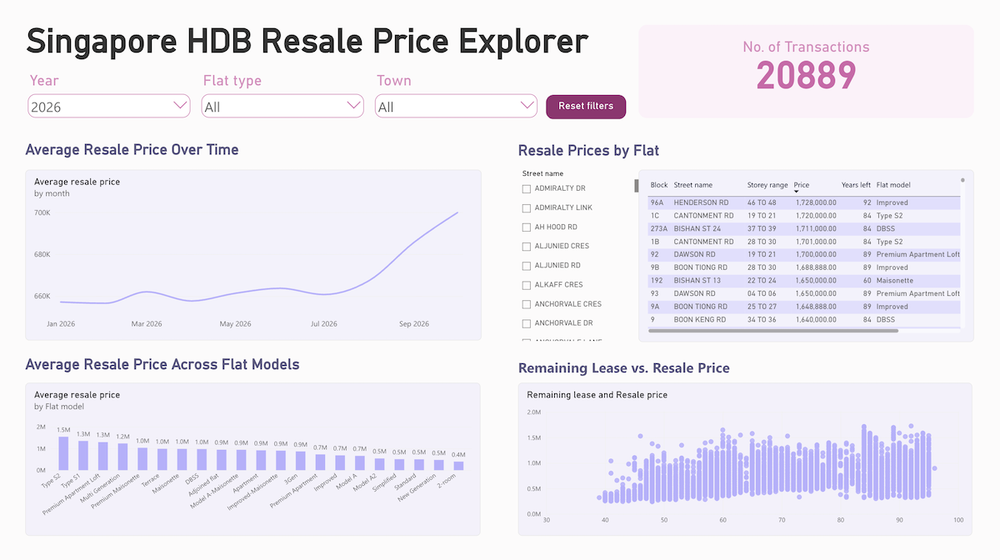

# Resale Flat Price Explorer

A full-stack data engineering and analytics project using historical Singapore resale flat price datasets and incremental records from data.gov.sg. The data is processed and stored in Databricks, then visualised through an interactive Power BI dashboard.

## Architecture

```text
Historical CSV Files / data.gov.sg API
        |
        v
Python & PySpark
        |
        v
Databricks Delta Table
        |
        v
Power BI Dashboard
```

## Tech stack
- **Programming**: Python, SQL, PySpark
- **Data Engineering**: Databricks, Apache Spark
- **Data Analytics/Visualisation**: Power BI

## Data Engineering Pipeline
- Combined historical datasets in Databricks.
- Implemented incremental API ingestion with checkpoint tracking.
- Transformed data using PySpark, including calculating remaining lease.
- Stored processed data in a Delta table.

## Data Analytics & Visualisation

🔗 [Click to watch the Power BI Dashboard demo](https://nsy-projects.s3.ap-southeast-1.amazonaws.com/hdb/power-bi-dashboard.mp4)

The interactive Power BI dashboard includes year, flat type and town slicers, allowing users to explore resale price patterns through the following visualisations:

1. Average Resale Price Over Time
2. Resale Prices by Flat
3. Average Resale Price Across Flat Models
4. Remaining Lease vs. Resale Price

## Data Source
🔗 [Resale Flat Prices](https://data.gov.sg/datasets?agencies=Housing+%26+Development+Board+(HDB)&sort=updatedAt&resultId=189)